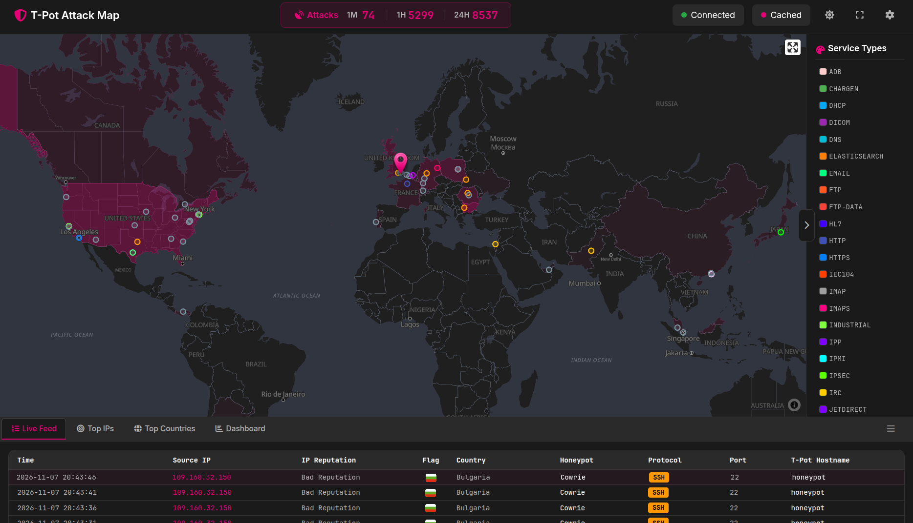
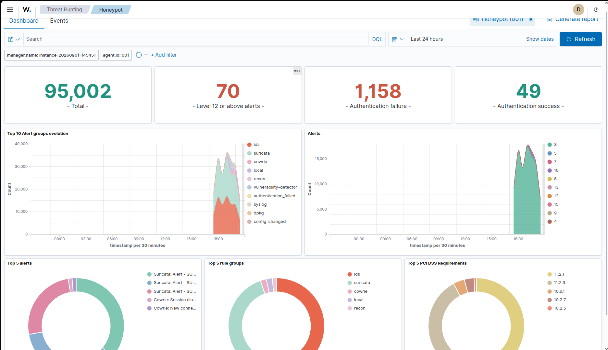

# Cloud Honeypot & SIEM Project

A self-hosted honeypot (T-Pot: Cowrie, Honeytrap) deployed on a Google Cloud VM, paired with a Wazuh SIEM instance running custom detection rules that correlate raw attack events into a single high-confidence "confirmed compromise" alert.

Built as a hands-on project to study live attacker behavior on the open internet and practice detection engineering, incident troubleshooting, and cloud/Linux systems administration.

<p float="left">
  
  
</p>

*Left: T-Pot's live attack map, showing real-time connections from across the internet against the exposed honeypot services. Right: the Wazuh dashboard over a 24h window - 95k+ total events, 1,158 authentication failures, 49 successes, and 70 alerts at level 12+ (the threshold where the custom correlation rules start flagging real attack activity).*

## Architecture

| Layer | Component | Role |
| --- | --- | --- |
| Infrastructure | Google Cloud Compute Engine VM (Ubuntu) | Hosts the honeypot and SIEM stack |
| Deception | T-Pot (Cowrie, Honeytrap, and other honeypots) | Simulates vulnerable SSH/Telnet and generic network services to attract attackers |
| Log storage & visualization | Elasticsearch + Kibana (bundled with T-Pot) | Indexes raw attack events; live map and dashboards |
| Detection & correlation | Wazuh manager | Parses Cowrie JSON logs, applies custom rules, generates severity-ranked alerts |
| Response | Wazuh Active Response (`firewall-drop`) | Automatically blocks attacker IPs on confirmed compromise |

Kibana visualizes raw events; Wazuh is the engine that decides which events matter and acts on them.

## Repository structure

```
.
├── README.md
├── wazuh-rules/
│   └── local_rules.xml        # Custom detection rules (100104-100109)
├── wazuh-config/
│   └── active-response.xml    # Active Response block from ossec.conf
└── sample-logs/
    ├── wazuh_sample_alerts.json   # Curated alert samples, one per rule
    └── cowrie_sample_session.json # A few representative Cowrie sessions
```

Logs here are a **curated sample**, not a full export — enough to show the detection chain firing on real traffic, without shipping gigabytes of raw data into a git repo.

## Custom detection engineering (Wazuh)

Built a four-stage correlation chain in `wazuh-rules/local_rules.xml` to turn raw Cowrie honeypot events into a single high-confidence alert, instead of flooding the dashboard with isolated low-value events:

1. **Brute-force detection** (`100106`) — frequency-based correlation: 10+ failed logins within 60 seconds from the same source IP.
2. **Malicious command detection** (`100107`) — PCRE2 regex match on executed commands (`wget`, `curl`, `chmod +x`, `base64 -d`, `/dev/shm`, reverse shells, etc.).
3. **Silent correlation marker** (`100108`, alert level 0, no visible alert) — fires when a file download is observed shortly after a malicious command, linking the two events by source IP.
4. **Confirmed compromise** (`100109`, alert level 15, maximum severity) — fires when a second malicious command follows the marker from step 3, capturing the realistic attack pattern: download a payload, then execute it.

Also debugged real Wazuh XML rule-loading failures (missing closing quotes, missing mandatory `<description>` tags) by reading manager error logs and validating every change with `wazuh-analysisd -t` before restarting — a single malformed rule disables the *entire* custom ruleset, so pre-flight validation is non-negotiable.

## Active Response design

Configured Wazuh Active Response to automatically block (via `firewall-drop`, 1-hour timeout) the source IP of any alert matching **only** the final "confirmed compromise" rule (`100109`) — deliberately not the earlier brute-force or single-command rules.

This is a deliberate trade-off: blocking too early kills the honeypot's intelligence-gathering value (you lose the chance to observe what the attacker does next), while waiting for a confirmed multi-stage compromise before blocking still cuts off real threats once they're proven, not just suspected.

Confirmed working end-to-end against the controlled test described above: rule 100109 firing triggered `firewall-drop` against the test source IP, with the block visible in `/var/ossec/logs/active-responses.log`.

## Incidents

### Disk-full boot failure and recovery

The VM stopped responding to SSH after the boot disk was resized from the GCP Console to 120 GB. Root cause analysis via the serial console showed `cloud-init` crashing with `OSError: [Errno 28] No space left on device`, even though the underlying disk had been enlarged.

**Diagnosis:** a GCP disk resize only grows the block device — the Linux partition and filesystem were still at their original ~50 GB and were 99.97% full, so `cloud-init` and the SSH key-sync agent couldn't write even small files.

**Recovery procedure:**

1. Stopped the affected instance and detached its boot disk.
2. Attached the disk as a secondary volume to a temporary rescue VM.
3. Used `growpart` to extend the partition to the full 120 GB.
4. Ran `e2fsck -f` to verify and repair the filesystem.
5. Ran `resize2fs` to extend the ext4 filesystem to the new partition size.
6. Reattached the repaired disk as the boot disk and restarted the original instance.

Result: disk usage dropped from 99.97% full (50 GB) to 16% used of 117 GB, with zero data loss and the honeypot fully operational again.

### Validating the correlation chain: two real bugs found by testing

Writing a correlation rule that *looks* correct isn't the same as one that *fires* correctly. After deployment, the two single-event rules (100100-100105, 100107) were generating alerts from real attacker traffic, but the three correlation rules (100106 brute-force, 100108 silent marker, 100109 confirmed compromise) never fired — despite hundreds of brute-force attempts in the logs that should have tripped 100106.

To debug this, I ran a controlled, self-targeted test: simulated a brute-force (12 failed SSH logins against my own honeypot in under 60 seconds), then a two-stage payload sequence in one persistent Cowrie session (`wget` a test file, then a later `chmod +x` on it) from a known source IP, and watched the Wazuh alert index for each correlation rule to fire.

Two real bugs surfaced:

1. **`<same_source_ip />` silently no-ops on custom JSON fields.** This tag compares Wazuh's internal normalized `srcip` field, which only auto-populates from a JSON key named exactly `srcip`. Cowrie's logs use `src_ip` (underscore), so `$(src_ip)` worked fine for interpolating into alert descriptions, but the cross-event IP comparison used for correlation had nothing to compare — it matched zero events, with no error raised. Fixed by switching to `<same_field>src_ip</same_field>`, which lets you name the actual JSON key to correlate on instead of relying on the implicit `srcip` mapping.
2. **`frequency` has an undocumented minimum of 2.** Setting `frequency="1"` (intending "this prior rule just needs to have matched once") throws `Invalid frequency: 1. Must be higher than 1 and lower than 10000` at rule-load time and disables the whole ruleset. For simple "did rule X match previously" correlation (as opposed to "did rule X match N times"), the fix is to omit `frequency` entirely and rely on `<if_matched_sid>` + `<timeframe>` alone.

After both fixes and a manager restart, the same controlled test produced the full chain live: 100107 (malicious command) → 100104 (download) → 100108 (silent marker, level 0) → 100109 (confirmed compromise, level 15) → Active Response blocking the test source IP. `sample-logs/wazuh_sample_alerts.json` captures one real alert per rule from this validated run.

## Skills demonstrated

Cloud infrastructure (Google Cloud Compute Engine, persistent disks, firewall rules, serial console access) · Linux systems administration (filesystem recovery, `growpart`/`resize2fs`/`e2fsck`, systemd services) · SIEM and detection engineering (Wazuh rule XML, event correlation, regex-based signatures) · incident troubleshooting under pressure (boot failures, service outages) · security tooling (Cowrie/Honeytrap/T-Pot, Elasticsearch/Kibana).
